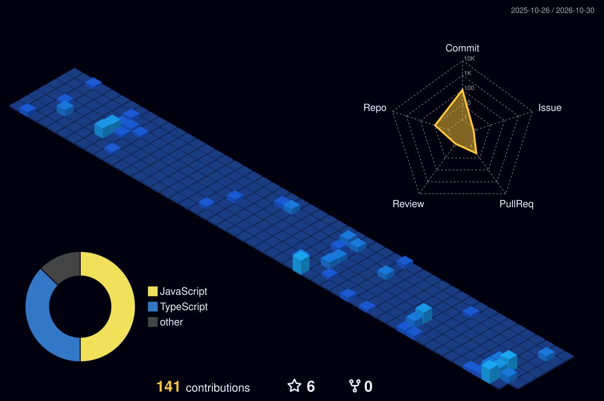
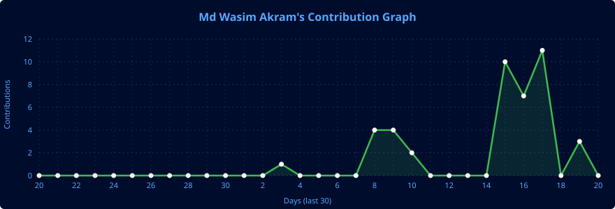
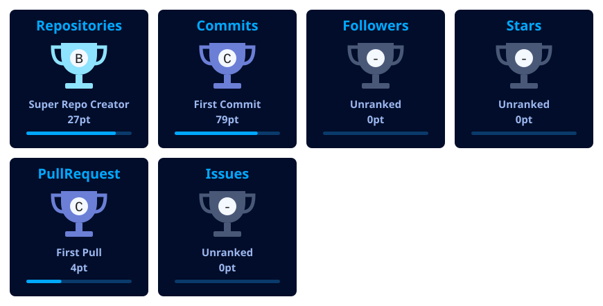

<p align="center">
  
</p>

<h1 align="center">Hi! I am Md Wasim Akram</h1>

<p align="center"><b>DevOps Engineer | AWS | Kubernetes | Terraform | GitOps | Cloud Infrastructure | Docker | CI/CD Automation</b></p>

<p align="center">
  <a href="mailto:wasim0039akram@gmail.com"></a>
  <a href="https://github.com/wasim0028"></a>
  <a href="https://github.com/wasim0028?tab=followers"></a>
  
</p>

<p align="center">
  <picture>
    <source media="(prefers-color-scheme: dark)" srcset="https://raw.githubusercontent.com/wasim0028/wasim0028/output/github-contribution-grid-snake-dark.svg" />
    
  </picture>
</p>

<p align="center">
  
</p>

<p align="center">
  
</p>

<h2 align="center">A b o u t &nbsp; M e</h2>

<p align="center">
  
</p>

I build and automate **secure, production-ready AWS platforms**: infrastructure as code, Kubernetes, GitOps and CI/CD pipelines that teams can deploy and trust. I also build full-stack applications with React, Node.js and TypeScript.

- **Infrastructure as Code** — modular Terraform (VPC, EKS, RDS, ECR, IAM/OIDC, Secrets Manager) with remote S3 state and locking
- **Kubernetes & GitOps** — run workloads on EKS and EKS Fargate, delivered with Argo CD and External Secrets
- **CI/CD & DevSecOps** — GitHub Actions with OIDC (no stored AWS keys), Trivy scans and SAST quality gates
- **Cloud** — AWS (EKS, ECS Fargate, RDS, ECR, IAM, S3, CloudWatch, SNS) with blue/green releases via CodeDeploy
- **Observability** — Prometheus, Grafana and CloudWatch alerting
- **Containers & configuration** — Docker, Docker Compose and reusable Ansible roles
- **Full-stack** — React, Node.js, TypeScript and MongoDB projects

```console
$ ls
about_me.txt     devops.sh     aws.yml

$ cat about_me.txt
# ABOUT ME
Infrastructure as Code
  Terraform modules · remote state · OIDC · IRSA

Kubernetes and GitOps
  EKS · EKS Fargate · Argo CD · External Secrets · Helm

CI/CD and DevSecOps
  GitHub Actions · CodeDeploy blue/green · Trivy · SAST

Observability
  Prometheus · Grafana · CloudWatch · SNS alerts

Containers and Automation
  Docker · Docker Compose · Ansible roles · distroless images

Full-Stack Development
  React · Node.js · TypeScript · MongoDB · Express
$ _
```

<p align="center">
  <a href="https://wasim0028.github.io">Portfolio</a> ·
  <a href="mailto:wasim0039akram@gmail.com">Email</a> ·
  <a href="https://github.com/wasim0028">GitHub</a>
</p>

---

### 🚀 Languages - Frameworks - Tools - Libraries - Workspace 🚀

<p align="center">
  
</p>

### Featured DevOps Projects

Production-style AWS projects: Terraform, EKS, GitOps and CI/CD. Every link goes to a public repository.

<table>
  <tr>
    <td width="33%" valign="top">
      <b><a href="https://github.com/wasim0028/yt-viewer-tracker">yt-viewer-tracker</a></b><br/>
      <sub>Live YouTube viewer tracker (React + Node.js + PostgreSQL) on AWS EKS Fargate. 8 modular Terraform modules with remote state, Argo CD GitOps, External Secrets, and a GitHub Actions pipeline using OIDC with no stored AWS keys.</sub><br/>
      <sub><code>EKS Fargate · Terraform · ArgoCD · External Secrets · GitHub Actions · Trivy</code></sub>
    </td>
    <td width="33%" valign="top">
      <b><a href="https://github.com/wasim0028/ElectionPulse-WB">ElectionPulse-WB</a></b><br/>
      <sub>React, ASP.NET Core and Python workloads on AWS EKS. Infrastructure as Code with Terraform (VPC, EKS, RDS, ECR), custom node group launch templates, least-privilege IAM via OIDC and IRSA, and GitOps via Argo CD.</sub><br/>
      <sub><code>AWS EKS · Terraform · ArgoCD · React · ASP.NET Core · Python</code></sub>
    </td>
    <td width="33%" valign="top">
      <b><a href="https://github.com/wasim0028/EvoGym">EvoGym</a></b><br/>
      <sub>Full-stack gym membership platform (React + TypeScript, Express/Prisma) deployed to AWS EKS Fargate via Terraform, GitHub Actions and Argo CD.</sub><br/>
      <sub><code>React · TypeScript · Prisma · EKS Fargate · Terraform · Argo CD</code></sub>
    </td>
  </tr>
</table>

### Application Projects

Other full-stack projects I have built:
[EstateHub](https://github.com/wasim0028/EstateHub) (Next.js + Django REST, Razorpay, S3) ·
[foodex](https://github.com/wasim0028/foodex) (MERN food delivery) ·
[ad-agency](https://github.com/wasim0028/ad-agency) (event and marketing dashboard)

---

## 📊 My Github Stats

<h3 align="center">【 S t a t s 】</h3>

<p align="center">
  
</p>

<p align="center">
  
</p>

<p align="center">
  
  
</p>

<details open>
<summary>📈 More Stats</summary>
<br/>

<p align="center">
  
</p>

<p align="center">
  
  
  
</p>

<p align="center">
  
</p>

<p align="center">
  
</p>

<p align="center">
  
</p>

</details>

<p align="center">
  
</p>
